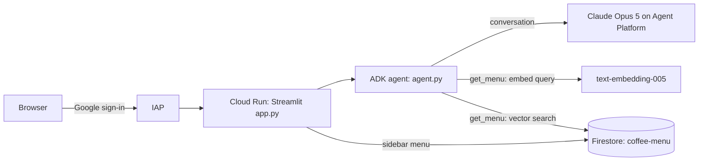

# ☕ Coffee Shop AI Barista

A Streamlit chat app where an AI barista recommends drinks and pastries from a coffee shop menu. The agent is built with the [Agent Development Kit (ADK)](https://google.github.io/adk-docs/) and runs on Anthropic's Claude Opus 5 through Gemini Enterprise Agent Platform. It grounds its answers in a menu stored in Firestore, using vector search. The app runs on Cloud Run behind Identity-Aware Proxy (IAP).

## How it works



1. `app.py` shows the chat and a sidebar menu that it reads from Firestore.
2. Each message goes to the ADK agent in `agent.py`, which sends the conversation to Claude.
3. When Claude needs menu data, it calls the `get_menu` tool. The tool embeds the request with `text-embedding-005` and runs a vector search in Firestore that returns the three closest items.
4. The agent's instructions tell Claude to recommend only items that the tool returns. Because the menu lives in Firestore, menu changes show up without a redeploy.

## Files

| File | What it does |
|---|---|
| `app.py` | Streamlit UI. Loads the sidebar menu from Firestore and runs the agent with ADK's `InMemoryRunner`. |
| `agent.py` | The ADK agent: the Claude model, the barista instructions, and the `get_menu` vector search tool. |
| `seed.py` | One-time setup script. Embeds each item in `menu.json` and writes it to Firestore. |
| `menu.json` | The menu: 8 drinks and pastries with prices, tags, and allergens. |
| `requirements.txt` | Pinned Python dependencies. Requires Python 3.10 or later. |
| `.gcloudignore` | Keeps `.venv/`, caches, and everything in `.gitignore` out of the Cloud Run upload. |
| `.gitignore` | Keeps `.venv/`, caches, `.env` files, and key files out of Git. The app doesn't need key files: it authenticates with ADC. |

## Configuration

The app reads these environment variables. The deploy command in [step 8](#8-deploy-the-app) sets them on Cloud Run.

| Variable | Value | Purpose |
|---|---|---|
| `GOOGLE_CLOUD_PROJECT` | Your project ID | Project for Claude and embedding requests. |
| `GOOGLE_GENAI_USE_ENTERPRISE` | `TRUE` | Makes the Gen AI SDK client in `get_menu` use Agent Platform with Application Default Credentials (ADC), not an API key. |
| `GOOGLE_CLOUD_LOCATION` | `global` | Location for embedding requests. |
| `CLAUDE_MODEL` | `claude-opus-5` (default) | Claude model ID. The model must be enabled in Model Garden. |
| `CLAUDE_LOCATION` | `global` (default) | Location for Claude requests. |

`seed.py` reads `PROJECT_ID` and `REGION` instead, which you export in step 1.

The Firestore database name (`coffee-menu`) and collection name (`menu`) are set in the code. If you change them, update `agent.py`, `app.py`, and `seed.py`.

## Deploy to Cloud Run

These steps create a Cloud Run service named `coffee-barista`, a Firestore database named `coffee-menu`, and a service account named `barista-agent-sa`. Run them from this directory, in Cloud Shell or a local terminal.

### Prerequisites

- A Google Cloud project with billing enabled.
- Permission to enable APIs, create service accounts, grant IAM roles, and deploy to Cloud Run, for example the Owner role.
- The gcloud CLI and Python 3.10 or later. Cloud Shell has both.
- In a local terminal, sign in and set up ADC, which `seed.py` uses:

  ```bash
  gcloud auth login
  gcloud auth application-default login
  ```

### 1. Set environment variables

Replace `YOUR_PROJECT_ID` with your project ID. `REGION` is where Cloud Run and Firestore run; change it to your closest region if you like. Claude requests go to Agent Platform's `global` endpoint wherever the app runs.

```bash
gcloud config set project YOUR_PROJECT_ID
export PROJECT_ID=$(gcloud config get-value project)
export PROJECT_NUMBER=$(gcloud projects describe $PROJECT_ID --format="value(projectNumber)")
export REGION=us-west1
```

### 2. Enable the APIs

```bash
gcloud services enable \
  run.googleapis.com \
  aiplatform.googleapis.com \
  cloudbuild.googleapis.com \
  artifactregistry.googleapis.com \
  firestore.googleapis.com \
  iap.googleapis.com
```

### 3. Enable Claude Opus 5

1. Open the [Claude Opus 5 model card](https://console.cloud.google.com/agent-platform/publishers/anthropic/model-garden/claude-opus-5) in Model Garden.
2. Click **Enable** and accept Anthropic's terms.

Then check that you can call the model:

```bash
curl -X POST \
  -H "Authorization: Bearer $(gcloud auth print-access-token)" \
  -H "Content-Type: application/json" \
  "https://aiplatform.googleapis.com/v1/projects/$PROJECT_ID/locations/global/publishers/anthropic/models/claude-opus-5:rawPredict" \
  -d '{
    "anthropic_version": "vertex-2023-10-16",
    "max_tokens": 100,
    "messages": [{"role": "user", "content": "Hello, Claude!"}]
  }'
```

A JSON reply from `claude-opus-5` means you're set. A `404` means the model isn't enabled yet. A `400` with `RESOURCE_PROJECT_INVALID` means `PROJECT_ID` is empty, so run step 1 again. `anthropic_version` is the request-format version that Agent Platform requires, not the model version.

### 4. Create the Firestore database

```bash
gcloud firestore databases create --database=coffee-menu --location=$REGION
```

### 5. Load the menu

Create a virtual environment, install the dependencies, and run the seed script:

```bash
python3 -m venv .venv
source .venv/bin/activate
pip install -r requirements.txt
python3 seed.py
```

The script prints `Firestore menu collection seeded with vector embeddings successfully!`

### 6. Create the vector index

```bash
gcloud firestore indexes composite create \
  --collection-group=menu \
  --query-scope=COLLECTION \
  --database=coffee-menu \
  --field-config=field-path=embedding,vector-config='{"dimension":"768", "flat": "{}"}' \
  --async
```

The dimension, 768, matches the size of `text-embedding-005` embeddings. The index takes a few minutes to build. You can keep going, but check that its `STATE` is `READY` before you test the app:

```bash
gcloud firestore indexes composite list --database=coffee-menu
```

### 7. Create the service account

The app runs as its own service account with only the two roles that it needs. Create the service account:

```bash
gcloud iam service-accounts create barista-agent-sa \
  --description="Service account for Coffee Barista ADK agent on Cloud Run" \
  --display-name="Barista Agent Service Account"
```

Let it call Claude and the embedding model on Agent Platform:

```bash
gcloud projects add-iam-policy-binding $PROJECT_ID \
  --member="serviceAccount:barista-agent-sa@$PROJECT_ID.iam.gserviceaccount.com" \
  --role="roles/aiplatform.user"
```

Let it read the menu from Firestore:

```bash
gcloud projects add-iam-policy-binding $PROJECT_ID \
  --member="serviceAccount:barista-agent-sa@$PROJECT_ID.iam.gserviceaccount.com" \
  --role="roles/datastore.user"
```

### 8. Deploy the app

```bash
gcloud run deploy coffee-barista \
  --source . \
  --region $REGION \
  --no-allow-unauthenticated \
  --iap \
  --command "/cnb/lifecycle/launcher" \
  --args "sh,-c,python3 -m streamlit run app.py --server.port=\$PORT --server.address=0.0.0.0" \
  --service-account "barista-agent-sa@$PROJECT_ID.iam.gserviceaccount.com" \
  --set-env-vars GOOGLE_GENAI_USE_ENTERPRISE=TRUE,GOOGLE_CLOUD_PROJECT=$PROJECT_ID,GOOGLE_CLOUD_LOCATION=global,CLAUDE_MODEL=claude-opus-5
```

The first deploy builds the container with Cloud Build and takes 3–5 minutes. If gcloud asks to create an Artifact Registry repository, answer `Y`.

| Flag | What it does |
|---|---|
| `--source .` | Builds the container from source with Google Cloud buildpacks, so you don't need a Dockerfile. |
| `--no-allow-unauthenticated`, `--iap` | Puts IAP in front of the app, so only people that you allow in step 9 can use it. Every message calls Claude, which is billed to your project. |
| `--command`, `--args` | Starts Streamlit on the port that Cloud Run provides. `\$PORT` is escaped so that the container expands it, not your shell. In the container, Streamlit must listen on `0.0.0.0` to receive requests. On buildpack images, `--args` only takes effect together with `--command "/cnb/lifecycle/launcher"`. |
| `--service-account` | Runs the app as `barista-agent-sa`, not the default Compute Engine service account, which often has broad Editor permissions. |
| `--set-env-vars` | Sets the variables in [Configuration](#configuration). |

Keep Streamlit's XSRF protection on. Some Streamlit deploy examples add `--server.enableXsrfProtection=false` and `--server.enableCORS=false`; don't add them here.

> [!NOTE]
> If your project isn't in an organization, gcloud might say that IAP needs first-time setup in the console. Open the service in the [Cloud Run console](https://console.cloud.google.com/run), click the **Security** tab, select **Require authentication** and then **Identity-Aware Proxy (IAP)**, and save. For details, see [Configure IAP for Cloud Run](https://docs.cloud.google.com/run/docs/securing/identity-aware-proxy-cloud-run).

### 9. Grant access through IAP

Allow IAP to invoke the service:

```bash
gcloud run services add-iam-policy-binding coffee-barista \
  --region $REGION \
  --member="serviceAccount:service-$PROJECT_NUMBER@gcp-sa-iap.iam.gserviceaccount.com" \
  --role="roles/run.invoker"
```

Give your account access to the app. To add other people, run the command again with `--member="user:EMAIL"` or `--member="group:GROUP_EMAIL"`.

```bash
gcloud iap web add-iam-policy-binding \
  --resource-type=cloud-run \
  --service=coffee-barista \
  --region=$REGION \
  --member="user:$(gcloud config get-value account)" \
  --role="roles/iap.httpsResourceAccessor"
```

### 10. Test the app

Get the service URL:

```bash
gcloud run services describe coffee-barista --region $REGION --format="value(status.url)"
```

Open the URL, sign in with your Google account, and try these prompts:

- "Recommend something strong and warm." The barista suggests the Espresso Solo.
- "Do you have a matcha frappuccino?" The barista politely says that it isn't on the menu.
- "I'm lactose intolerant, what can I get?" The barista suggests only dairy-free items.

New IAP access can take a few minutes to work. If you get an access error, wait a minute and refresh.

## Run locally

Local runs use the same Firestore database and Claude model, so finish deploy steps 1–6 first. Your account needs permission to call Agent Platform and read Firestore, for example the Owner role or the two roles from step 7.

```bash
source .venv/bin/activate
export GOOGLE_GENAI_USE_ENTERPRISE=TRUE GOOGLE_CLOUD_PROJECT=$PROJECT_ID GOOGLE_CLOUD_LOCATION=global
streamlit run app.py --server.address=localhost
```

Open http://localhost:8501. The `--server.address=localhost` flag keeps the app private to your machine.

## Common tasks

**Update the menu.** Edit `menu.json`, and then run `python3 seed.py` again with `PROJECT_ID` and `REGION` exported. Refresh the app to see the changes; you don't need to redeploy. `seed.py` only adds or overwrites items, keyed by name. To remove or rename an item, also delete its old document in the [Firestore console](https://console.cloud.google.com/firestore).

**Redeploy after code changes.** The settings from step 8 carry over, so you only need to run:

```bash
gcloud run deploy coffee-barista --source . --region $REGION
```

**Switch the Claude model.** Enable the model in Model Garden, and then update the variable. Cloud Run reuses the same container image, so there's no rebuild.

```bash
gcloud run services update coffee-barista --region $REGION --update-env-vars CLAUDE_MODEL=claude-sonnet-5
```

**Read the logs.**

```bash
gcloud run services logs read coffee-barista --region $REGION --limit 50
```

## Troubleshooting

| Problem | What to check |
|---|---|
| `404` when calling Claude | Enable the model in Model Garden, and check the spelling of `CLAUDE_MODEL`. |
| `ValueError: Model claude-opus-5 not found` | Pass a `Claude` instance to `LlmAgent`, as `agent.py` does. ADK only recognizes `claude-3-*` and `claude-*-4*` model-name strings on its own. |
| The page shows "Sorry, the menu isn't available right now", or the barista can't read the menu | Check that the `coffee-menu` database exists, the service account has `roles/datastore.user`, and the vector index is `READY`. The full error is in the [logs](#common-tasks). |
| The barista replies "Sorry, I ran into a problem" | Read the [logs](#common-tasks) for the full error. The app shows users only a generic message, because error details can include your project ID. |
| Access error in the browser | Check your IAP access from step 9. New grants can take a few minutes. |

## Production notes

This app is a sample. Before you use it in production, keep these points in mind:

- **Chat history is kept in memory.** `InMemoryRunner` stores sessions in the container, so they're lost when the page refreshes and aren't shared between instances. Use a persistent ADK session service.
- **Rendering.** Menu data and Claude's replies are rendered with `st.markdown`, which doesn't run HTML. Use `unsafe_allow_html=True` only for the static header and CSS.
- **Cost.** Every message calls Claude. Limit who has IAP access, cap instances with `--max-instances`, and set a budget alert. See [Agent Platform pricing](https://cloud.google.com/gemini-enterprise-agent-platform/generative-ai/pricing).

## Clean up

> [!CAUTION]
> These commands permanently delete the app and its menu data.

```bash
gcloud run services delete coffee-barista --region $REGION --quiet
gcloud artifacts docker images delete \
  $REGION-docker.pkg.dev/$PROJECT_ID/cloud-run-source-deploy/coffee-barista \
  --delete-tags --quiet
gcloud iam service-accounts delete barista-agent-sa@$PROJECT_ID.iam.gserviceaccount.com --quiet
gcloud firestore databases delete --database=coffee-menu --quiet
```

## Learn more

- [ADK: Claude models on Agent Platform](https://google.github.io/adk-docs/agents/models/agent-platform/#anthropic-claude)
- [Claude models on Agent Platform](https://docs.cloud.google.com/gemini-enterprise-agent-platform/models/partner-models/claude)
- [Firestore vector search](https://docs.cloud.google.com/firestore/native/docs/vector-search)
- [Configure IAP for Cloud Run](https://docs.cloud.google.com/run/docs/securing/identity-aware-proxy-cloud-run)
